<div align="center">

<br />



<br /><br />

**Independent software engineering studio built by three developers.**  
*High-utility desktop tools, mobile software, and local-first utilities. Free for lifetime with zero subscriptions.*

<br />

```
========================================================================
  STATUS: ACTIVE WORKSHOP  |  MEMBERS: 3 DEVELOPERS  |  MODEL: 100% FREE
========================================================================
```

<br />

[Official Website](https://github.com/codeandchaos-studio/codeandchaos-website) • [Software Releases](https://github.com/codeandchaos-studio) • [Contact the Studio](mailto:codeandchaos.studio@gmail.com)

<br />

---

</div>

## Welcome to the Workshop

Three developers, zero corporate bureaucracy, and a deep dislike for monthly software subscriptions. 

We spend month after month engineering local-first desktop applications, mobile tools, and experimental utilities. Everything you see here was built by hand out of genuine personal need, because existing commercial software became slow, bloated, or hidden behind recurring paywalls.

We believe in radical transparency: you deserve to see how the software you run on your computer is built, how it operates, and why it respects your machine.

---

## The Studio Handshake (How We Operate)

We keep our blueprints out in the open so you can read, audit, and explore our work with total peace of mind. In return, we ask for a simple, calm understanding between software people:

> **1. Look around, inspect the gears**  
> Every repository here is published on a **view-only basis** for technical transparency, architectural review, and security verification. You are welcome to read and study every line of code.

> **2. Leave the machinery in the shop**  
> Please do not clone (`git clone`), scrape, or duplicate our repositories to re-upload or repackage them. If you want to use our applications, they are already 100% free for you to download and enjoy directly from our website and release hub.

> **3. No forks in the road**  
> Repository forking is restricted to our internal studio pipeline. We maintain our tools directly so users always get verified, safe, and stable releases without fragmented clones floating around.

> **4. Honor the craftsmanship**  
> We have poured late nights and months of human engineering into these tools. Please do not decompile, reverse engineer, or extract proprietary runtime logic from our compiled binaries (`.exe`, `.apk`, `.zip`).

> **5. Zero commercial exploitation**  
> None of our software, code, or interface designs may be sold, resold, sublicensed, or wrapped into commercial products. We give our tools away freely; no one should profit off work meant for everyone.

> **6. The three of us at the bench**  
> All intellectual property, trademarks, and architectural designs remain with our three-developer collective. Full administrative, branch, and release privileges belong exclusively to our verified studio team.

---

## Studio Specifications

| Specification | Our Standard | Why It Matters |
| :--- | :--- | :--- |
| **User Cost** | **$0.00 / Free Forever** | No 7-day trials, no credit card forms, no subscription fatigue. |
| **Source Model** | **View-Only Transparency** | Full architectural clarity, with code protected from unauthorized cloning. |
| **Telemetry & Tracking** | **Zero / None** | No analytics SDKs, no tracking pixels, no behavioral profiling. |
| **Storage Architecture** | **Local-First** | Your data lives on your disk in plain formats, never trapped in a remote cloud. |
| **Team Size** | **Three Developers** | Lean, focused, and free from investor influence. |

---

## Active Projects

| Project | Target Platforms | Concept & Focus | Status |
| :--- | :--- | :--- | :--- |
| **D-Deck** | Windows, Android | Distraction-free floating task HUD with persistent audio sprint chimes. | Production Release (`v1.0.0`) |
| **Diverge** | Web, Windows, Android | Clean music streaming client engineered to reverse Spotify-style paywalls. | In Active Build (`v0.9.1-beta`) |
| **AR-NavSense** | Android | Native tactical pedestrian navigation utility for visually impaired walkers. | Production Release (`v1.0.4`) |

---

<div align="center">


<br />

**CODE & CHAOS**  
`we build stuff.`  
*Handcrafted human software engineering. All Rights Reserved.*

</div>
