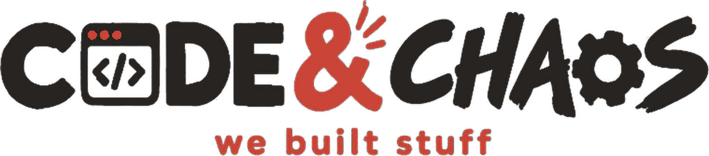

 

  

**Independent software engineering studio built by three developers.**  
*High-utility desktop tools, mobile software, and local-first utilities. 100% free for lifetime with zero subscriptions.*

 

[Official Website Repository](https://github.com/codeandchaos-studio/codeandchaos-website) • [Studio Contact](mailto:codeandchaos.studio@gmail.com)

 

---

## Important Notice: Studio Repository Directives

Please read these directives before inspecting any Code & Chaos repositories. All software, user interfaces, documentation, and architectural designs published under this organization are proprietary intellectual property governed by the **Code & Chaos Source-Available View-Only License**.

### 1. View-Only Transparency
Repositories published within this organization are made accessible strictly for technical transparency, architectural review, and public security auditing. Reading and inspecting the code is welcomed.

### 2. Strict Prohibition on Cloning and Scraping
- Public visitors, automated scrapers, and third-party developers are **strictly prohibited from cloning (`git clone`), downloading archive packages of, scraping, or duplicating** any repository or source file.
- Cloning and synchronization privileges are restricted exclusively to verified Code & Chaos studio owners.

### 3. Strict Prohibition on Forking
- **Repository forking is restricted.** Creating forks, derivative mirrors, or duplicate repositories on GitHub or any other VCS hosting provider is unauthorized.

### 4. Zero Reverse Engineering
- Decompiling, disassembling, reverse engineering, analyzing runtime memory structures, or attempting to derive source code from compiled production binaries (`.exe`, `.apk`, `.zip`) is strictly prohibited.

### 5. No Commercial Exploitation or Derivative Works
- You may not sell, resell, bundle, repackage, or distribute any part of our software.
- You may not create derivative products, clones, or commercial spin-offs based on our codebase or interface designs.

### 6. Ownership and Access Privileges
- All rights, titles, and intellectual property remain exclusively with the three core developers of Code & Chaos.
- Administrative, branch, merge, push, and release privileges are held exclusively by verified studio owners.

---

## Studio Philosophy

- **Code represents engineering.** Fast, local-first code that respects system resources and user privacy.
- **Chaos represents experimentation.** Solving stubborn workflow friction without corporate bureaucracy.
- **Lifetime Free Promise:** Every application we build is free for lifetime. Zero subscriptions, zero 7-day trial traps, zero credit card prompts, zero third-party advertising SDKs, and zero background telemetry.

---

## Active Software Catalog

| Project | Target Platforms | Core Focus | Status |
| :--- | :--- | :--- | :--- |
| **D-Deck** | Windows, Android | Distraction-free floating task HUD with persistent sprint chimes | Production Release (`v1.0.0`) |
| **Diverge** | Web, Windows, Android | Local-first music streaming player reversing subscription paywalls | In Active Build (`v0.9.1-beta`) |
| **AR-NavSense** | Android | Native tactical pedestrian navigation utility for visually impaired | Production Release (`v1.0.4`) |

---

 

**CODE & CHAOS**  
`we build stuff.`  
*Handcrafted human software engineering. All Rights Reserved.*

